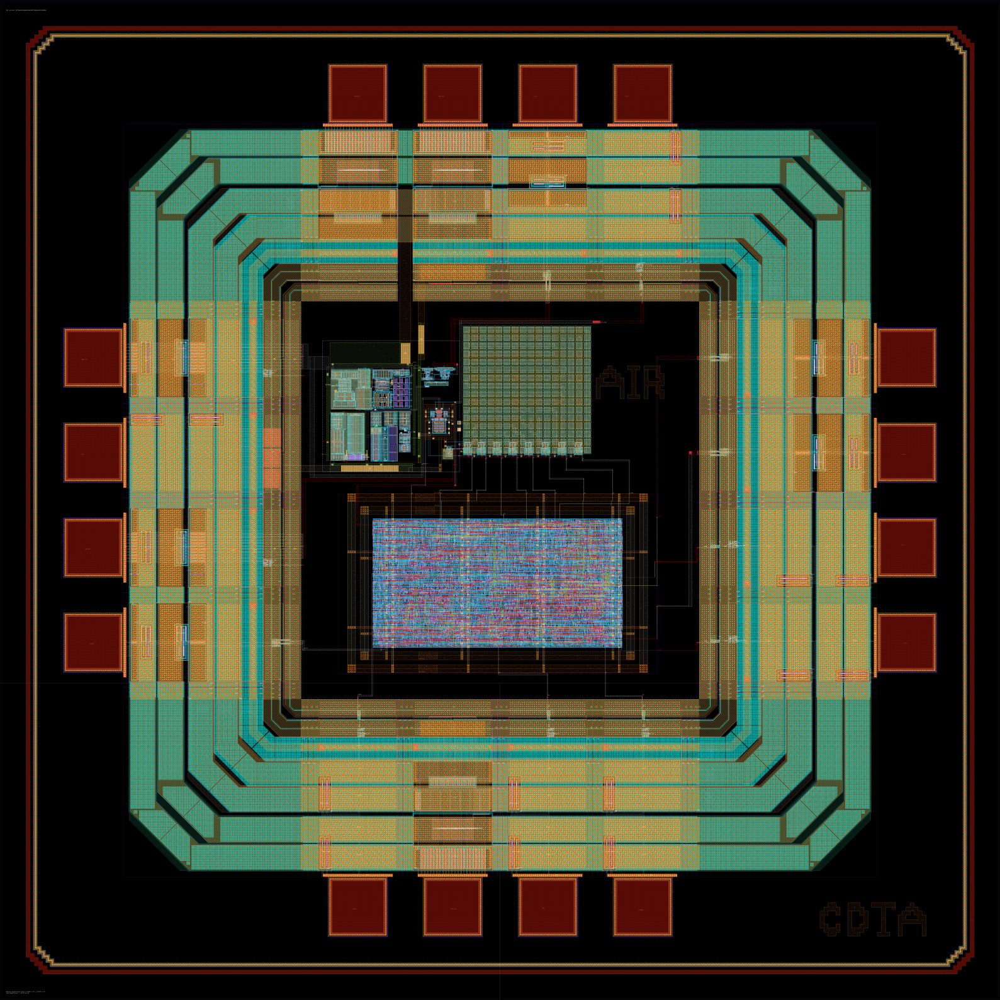

# SoC8767 — Combustible Gas Monitoring Mixed-Signal SoC

Single-technology IP library and mixed-signal tapeout deliverable.

- `doc/` : Architectural, pinout, and bonding documentation
- `dependencies/` : Sub-cells, analog hard macros, and digital RTL
- `release/v.1.0.0` : Tapeout GDSII, LEF, DEF, and timing deliverables



| Attribute | Specification |
| :--- | :--- |
| **Category** | Mixed-Signal Sensor SoC |
| **PDK / Technology** | IHP SG13G2 (130 nm BiCMOS / CMOS) |
| **Top Cell** | `SoC8767` |
| **Die Size** | 1.0 mm × 1.0 mm |
| **Package** | QFN-24 (4.0 mm × 4.0 mm, 0.5 mm pitch, exposed DAP) |
| **License** | Apache-2.0 |

---

## Overview

**SoC8767** is a low-power, purpose-built mixed-signal System-on-Chip designed for combustible gas detection (LPG, propane, methane, and hydrogen across 300–10,000 ppm) with direct interfacing to $SnO_2$-based chemiresistive gas sensor elements (e.g., MQ-2/MQ-5 front-ends). 

The SoC integrates the complete analog readout chain, power management unit (PMU), on-chip clock generation, threshold-comparison engine, and an I2C slave telemetry interface, eliminating external active signal conditioning components.

---

## Target Applications

- **Residential Gas Leak Alarms:** Direct alerting for LPG, butane, and natural gas hazards in domestic kitchens.
- **Industrial Safety Monitors:** Continuous propane and combustible gas monitoring in warehouses and plant rooms.
- **Field & Portable Sniffers:** Battery-operated handheld detectors for line inspection and maintenance teams.
- **Smart HVAC & Ventilation:** Automated trigger for exhaust hoods and airflow systems upon threshold crossing.
- **Confined-Space Safety:** Compact gas warning modules for marine vessels, RVs, and caravans.

---

## Key Features

- **Integrated Power Management Unit (PMU):**
  - **1.0 V Bandgap Reference (BGR):** High-PSRR internal reference voltage with dedicated off-chip bypass pin.
  - **1.2 V Core LDO Regulator:** Generates stable internal core supply from an external 3.3 V I/O rail, featuring dedicated Kelvin sense and external decoupling.
- **Analog Front-End (AFE) & Readout:**
  - **8-bit SAR ADC:** Direct digitization of analog sensor output without intermediate op-amp buffers.
  - **Sensor Interface:** Configurable input conditioning for sensor voltage dividers.
- **Timing & Oscillators:**
  - **Integrated 8 MHz Oscillator / VCO:** Internal system clock reference.
  - **Clock Test Access:** Dedicated digital input and analog clock monitor pads for silicon characterization.
- **Digital Core & Telemetry:**
  - **Autonomous Alarm FSM:** Fast hardware threshold comparator with programmable alarm output assertion.
  - **I2C Slave Interface:** 7-bit addressing with hardware address pin (`ADDR0`), standard/fast mode support, and full register telemetry.
  - **Power Sequencer:** Programmable duty-cycling states to maximize battery operational lifespan.

---

## Electrical Characteristics

| Parameter | Symbol | Min | Typ | Max | Unit |
| :--- | :--- | :---: | :---: | :---: | :---: |
| I/O & External Supply Voltage | $V_{DD,IO}$ | 3.0 | 3.3 | 3.6 | V |
| Regulated Core Digital Supply | $V_{DD,1V2}$ | 1.14 | 1.20 | 1.26 | V |
| Internal Bandgap Voltage | $V_{BG}$ | 0.98 | 1.00 | 1.02 | V |
| Analog Input Voltage Range | $V_{IN}$ | 0 | — | 1.0 | V |
| ADC Resolution | $N_{ADC}$ | — | 8 | — | Bits |
| System Clock Frequency | $f_{CLK}$ | — | 8.0 | — | MHz |
| Operating Temperature | $T_A$ | -40 | 25 | 85 | °C |

---

## Pinout and Padframe Mapping

The SoC uses a standard pad ring interfacing to a **QFN-24** cavity.

| Pad # | Pad Name | Standard Direction | Electrical Domain | Function / Description |
| :---: | :--- | :--- | :--- | :--- |
| **1** | `VBG_1V0` | `Analog Output` | Analog (1.0 V) | 1.0 V bandgap reference output / bypass cap |
| **2** | `VSS` | `Supply / Ground` | Ground | Core / substrate ground |
| **3** | `VIN_SENSE` | `Analog Input` | Analog | Gas sensor analog input to 8-bit SAR ADC |
| **4** | `ALARM_OUT` | `Output` | Digital (3.3 V) | Latched gas alarm threshold flag |
| **5** | `RESET_N` | `Input` | Digital (3.3 V) | Active-low master reset (internal pull-up) |
| **6** | `VDD_CORE_1V2` | `Power / Output` | Regulated (1.2 V) | 1.2 V LDO regulated output (Node 1 / Decoupling) |
| **7** | `I2C_ADDR0` | `Input` | Digital (3.3 V) | I2C address bit 0 select (pull-down/pull-up) |
| **8** | `CHIP_EN` | `Input` | Digital (3.3 V) | Global chip enable (active high) |
| **9** | `I2C_SDA` | `Inout` | Digital (Open-Drain) | I2C serial data line |
| **10** | `I2C_SCL` | `Inout` / `Input` | Digital (Open-Drain) | I2C serial clock line |
| **11** | `CLK_DIG_IN` | `Input` | Digital (3.3 V) | External digital test clock input |
| **12** | `CLK_ANA_OUT` | `Output` | Analog / Clock | 8 MHz internal clock monitor output |
| **13** | `VDD_1V2_SENSE`| `Power / Output` | Regulated (1.2 V) | 1.2 V LDO output (Node 2 / Kelvin sense) |
| **14** | `VDD_IO_3V3` | `Supply / Power` | Pad Ring (3.3 V) | External 3.3 V supply input |
| **15–24**| `NC / TEST` | — | — | Reserved / No Connect (tie to GND or float per packaging) |
| **DAP** | `EPAD / VSS` | `Substrate` | Ground | Exposed Die Attach Paddle (down-bonded to GND) |

---

## Package Specifications (QFN-24)

- **Package Dimensions:** $4.0\text{ mm} \times 4.0\text{ mm} \times 0.85\text{ mm}$ (JEDEC MO-220 compliant).
- **Die Cavity / DAP:** $2.7\text{ mm} \times 2.7\text{ mm}$ exposed central paddle.
- **Lead Pitch:** $0.50\text{ mm}$.
- **Lead Center Coordinates:** $\pm 0.25\text{ mm}, \pm 0.75\text{ mm}, \pm 1.25\text{ mm}$ along each edge.
- **Bond Landing Radius:** $1.70\text{ mm}$ from package center.
- **Pin 1 Indexing:** Counter-clockwise convention starting from the top-left index mark:
  - Leads 1–6: Left edge (top to bottom)
  - Leads 7–12: Bottom edge (left to right)
  - Leads 13–18: Right edge (bottom to top)
  - Leads 19–24: Top edge (right to left)

---
")

## Prerequisites and Toolchain

Building, simulating, or running DRC/LVS requires the following open-source EDA tools:

- [IHP SG13G2 Open PDK](https://github.com/IHP-GmbH/IHP-Open-PDK) (130 nm BiCMOS)
- [OpenLane 2 / LibreLane](https://github.com/efabless/librelane) — Automated RTL-to-GDSII flow
- [KLayout](https://www.klayout.de/) — Layout viewing, DRC, and GDS verification
- [Xschem](https://xschem.sourceforge.io/) & [Ngspice](https://ngspice.sourceforge.io/) — Schematic capture and mixed-signal simulation
- [Icarus Verilog](http://iverilog.icarus.com/) & [GTKWave](https://gtkwave.sourceforge.net/) — Digital behavioral testbenches and waveform analysis

---

## License

Licensed under the [Apache License, Version 2.0](https://www.apache.org/licenses/LICENSE-2.0).

```text
Copyright 2026 SoC8767 Authors

Licensed under the Apache License, Version 2.0 (the "License");
you may not use this file except in compliance with the License.
You may obtain a copy of the License at

    [http://www.apache.org/licenses/LICENSE-2.0](http://www.apache.org/licenses/LICENSE-2.0)

Unless required by applicable law or agreed to in writing, software
distributed under the License is distributed on an "AS IS" BASIS,
WITHOUT WARRANTIES OR CONDITIONS OF ANY KIND, either express or implied.
See the License for the specific language governing permissions and
limitations under the License.