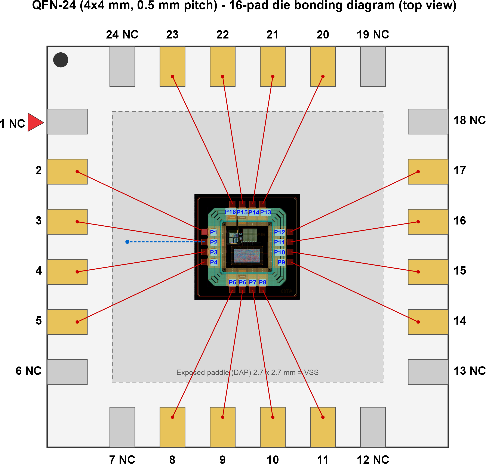

# **SoC8767 Gas Sensor SoC: Packaging and Bonding Documentation** 

Prepared by Farah Ridha for IHP (assembly / packaging request). Design: SoC8767, release v.1.0.0. Repository: https://github.com/CDTA-DMN/IHP__SoC8767 

## **1. Request summary** 

We request assembly of the SoC8767 die into a QFN-24 package (4 mm x 4 mm, 0.5 mm pitch, 6 leads per side, exposed die paddle). The die has 16 peripheral bond pads (4 per side). On each side the 4 pads connect to the 4 central leads; the 2 corner leads of each side are left unconnected (NC). The substrate (VSS) is also down-bonded to the exposed paddle. 

## **2. Die pad list** 

Pad numbering runs counter-clockwise starting at the top of the left side: P1 to P4 left (top to bottom), P5 to P8 bottom (left to right), P9 to P12 right (bottom to top), P13 to P16 top (right to left). Coordinates were extracted from the GDS. Origin (0,0) is the centre of the die, Y up, in um; the second pair is relative to the die center. 

|Pad|Signal|Side|X, Y (um, die centre origine)|X, Y (um, lower- left of the die)|Direction of Pad|Function (from design labels)|
|---|---|---|---|---|---|---|
|P1|BGR_1V0|Left|-407.5, 142.9|92.5, 642.9|Analog In/Output|1.0 V bandgap reference output|
|P2|VSS|Left|-407.5, 47.9|92.5, 547.9|Supply / Ground|Ground / substrate|
|P3|IN_SENS|Left|-407.5, -47.6|92.5, 452.4|Analog Input|Sensor analog input to ADC|
|P4|ALARM|Left|-407.5, -142.5|92.5, 357.5|Output|Alarm output|
|P5|RESET|Bottom|-142.5, -407.5|357.5, 92.5|Input|Reset input|
|P6|VDD_1V2|Bottom|-47.6, -407.5|452.4, 92.5|Power / Output|1.2 V LDO node|
|P7|AD0|Bottom|47.9, -407.5|547.9, 92.5|Input|I2C device address bit 0 (Input, active high/low) with internal pull-down/pull-up.|
|P8|ENABLE|Bottom|142.9, -407.5|642.9, 92.5|Input|Enable input|
|P9|I_SDA|Right|407.5, -142.5|907.5, 357.5|Input|I2C SDA (input side)|
|P10|I_SCL|Right|407.5, -47.6|907.5, 452.4|Input|I2C SCL (input side)|
|P11|O_SDA|Right|407.5, 47.9|907.5, 547.9|Output|I2C SDA (output side)|
|P12|O_SCL|Right|407.5, 142.9|907.5, 642.9|Output|I2C SCL (output side)|
|P13|CLK_D|Top|142.9, 407.5|642.9, 907.5|Input|Digital clock pad|
|P14|CLK_A|Top|47.9, 407.5|547.9, 907.5|Output|Analog clock pad|
|P15|VDD_1V2|Top|-47.6, 407.5|452.4, 907.5|Power / Output|1.2 V LDO node|
|P16|VDD_3V3|Top|-142.5, 407.5|357.5, 907.5|Supply / Power|3.3 V external supply|

## **3. QFN-24 package and pin mapping** 

Pin 1 is the first lead on the left side nearest the top-left corner dot. Pins run counter-clockwise: 1 to 6 left (top to bottom), 7 to 12 bottom (left to right), 13 to 18 right (bottom to top), 19 to 24 top (right to left). 

|Pkg pin|Pad|Signal|Notes|
|---|---|---|---|
|1|-|NC|Corner lead, no bond|
|2|P1|BGR_1V0||
|3|P2|VSS|Also down-bonded to DAP|
|4|P3|IN_SENS||
|5|P4|ALARM||
|6|-|NC|Corner lead|
|7|-|NC|Corner lead|
|8|P5|RESET||
|9|P6|VDD_1V2||
|10|P7|AD0||
|11|P8|ENABLE||
|12|-|NC|Corner lead|
|13|-|NC|Corner lead|
|14|P9|I_SDA||
|15|P10|I_SCL||
|16|P11|O_SDA||
|17|P12|O_SCL||
|18|-|NC|Corner lead|
|19|-|NC|Corner lead|
|20|P13|CLK_D||
|21|P14|CLK_A||
|22|P15|VDD_1V2||
|23|P16|VDD_3V3||
|24 DAP|- P2 (VSS)|NC VSS|Corner lead|

## **5. Bonding diagram** 

The to-scale top view (lead frame, die, 16 pads, wires and DAP down-bond) is provided as the following pictures 

<!-- Start of picture text -->
QFN-24 (4x4 mm, 0.5 mm pitch) - 16-pad die bonding diagram (top view)

## **6. Assembly requirements and requests** 

- Wire bonding: gold wire, ball-wedge, diameter to be proposed by IHP assembly for a 55.8 um pad opening. 

- Die attach: conductive adhesive onto the exposed paddle, so the die substrate is grounded through the backside as well as through the VSS down-bond. 

- Exposed paddle: connected to VSS (printed circuit board ground). 

- VSS pad (P2): one wire to lead 3 and one wire to the paddle. We ask IHP to advise whether this is done as two wires on the pad or as a stitch bond on the first ball. 

- NC leads (1, 6, 7, 12, 13, 18, 19, 24): left unbonded and electrically floating. 

